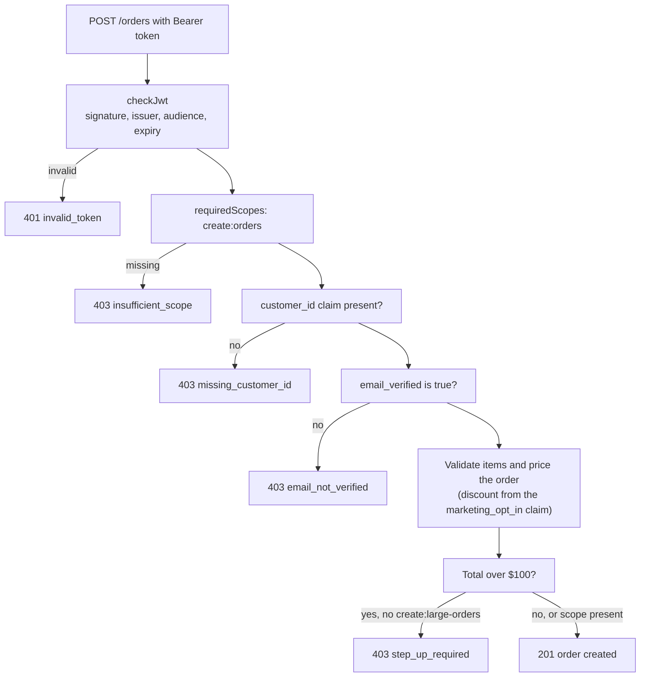

# Pizza 42 API

Express orders API for Pizza 42. It validates Auth0 access tokens and enforces scopes. The Angular app is in
[pizza-42](https://github.com/MattM-1/pizza-42) and the Auth0 tenant configuration is in
[pizza-42-auth0](https://github.com/MattM-1/pizza-42-auth0).

Hosted at https://pizza-42-api.onrender.com (`/health` is public).

## Endpoints

| Method | Path | Needs | Notes |
|---|---|---|---|
| GET | `/health` | nothing | liveness check |
| POST | `/orders` | `create:orders` + verified email | body: `{ "items": [{ "pizzaId": "answer", "size": "L", "qty": 2 }] }`. Orders over $100 (after discount) also need `create:large-orders` |
| GET | `/orders` | `read:orders` | the caller's own orders only |

Valid `pizzaId`s: `margherita`, `pepperoni`, `funghi`, `quattro`, `veggie`, `answer`. Sizes: `S`, `M`, `L`.

Prices are calculated on the server, so the client can't set its own price. Errors:

| Status | Body | When |
|---|---|---|
| `401` | `invalid_token` | missing, malformed, expired, wrongly signed, or wrong issuer or audience |
| `403` | `insufficient_scope` | the token lacks the endpoint's scope |
| `403` | `missing_customer_id` | the access token has no customer ID claim |
| `403` | `email_not_verified` | the access token doesn't have `email_verified: true` |
| `403` | `step_up_required` | order over $100 and no `create:large-orders` in the token |
| `400` | `invalid_request` | unknown pizza or size, bad quantity, empty or oversized order |

## How requests are checked



`checkJwt` comes from Auth0's `express-oauth2-jwt-bearer`. It verifies the signature against the tenant's public keys,
and checks the issuer (`https://<tenant>/`), the audience and the expiry. Tokens signed with an unsupported algorithm,
including unsigned `alg: none` tokens, are rejected with `401`.

## Claims the API relies on

All of these come from the signed access token, never from the request body. Auth0 post-login Actions set them.

| Claim | Set by (Auth0 Action) | Used for |
|---|---|---|
| `scope` (`create:orders`, `read:orders`) | Assign Customer Role, or the `customer` role through RBAC | Endpoint access |
| `scope` (`create:large-orders`) | Add High-Level Scopes, only after MFA in that login | Orders over $100 |
| `email_verified` (standard claim, not namespaced) | Add Email Verified Access Token Claim | Only verified customers can place orders |
| `https://pizza42.example.com/marketing_opt_in` | Marketing | 15% discount, which also decides whether an order is over $100 |
| `https://pizza42.example.com/customer_id` | Add Customer ID | Owner of each order, and which orders `GET /orders` returns |

## Run

```bash
npm install
cp .env.example .env     # then check the values
npm run dev              # http://localhost:3001
npm test                 # pricing unit tests
```

Requires Node `^22.22.3 || ^24.15.0 || ^26.0.0` (uses `node --env-file`).

Environment variables: `AUTH0_DOMAIN`, `AUTH0_AUDIENCE`, `ALLOWED_ORIGIN` (one origin or a comma-separated list, no
trailing slashes) and `CLAIMS_NAMESPACE`. `AUTH0_DOMAIN` and `AUTH0_AUDIENCE` are required.

## Auth0 setup this expects

- API identifier `https://api.pizza42.example.com` (no trailing slash), RS256, RBAC on, "Add Permissions in the Access Token" on.
- Permissions defined on the API: `create:orders`, `read:orders`, `create:large-orders`.
- `create:large-orders` is NOT on the `customer` role. A post-login Action adds it only after a successful step-up.
- The Angular app requests this audience and the `create:orders read:orders` scopes.
- The post-login Actions in the Auth0 repo add the claims listed above.

## Quick test with curl

Without a token, the API refuses:

```bash
curl -i -X POST http://localhost:3001/orders \
  -H "Content-Type: application/json" \
  -d '{"items":[{"pizzaId":"answer","size":"M","qty":1}]}'
# 401 Unauthorized
```

With a token for the API (for example from the Angular app's network tab):

```bash
curl -X POST http://localhost:3001/orders \
  -H "Authorization: Bearer $TOKEN" -H "Content-Type: application/json" \
  -d '{"items":[{"pizzaId":"answer","size":"M","qty":1}]}'
```

## Hosting (Render Web Service)

| Setting | Value |
|---|---|
| Build command | `npm install` |
| Start command | `npm start` |
| Health check path | `/health` |
| Environment variables | `AUTH0_DOMAIN`, `AUTH0_AUDIENCE`, `ALLOWED_ORIGIN`, `CLAIMS_NAMESPACE` |
| Auto-deploy | On every push to `main` |

`ALLOWED_ORIGIN` must list the hosted app's origin (`https://pizza-42.onrender.com`). CORS is an exact-origin allowlist.
It is safe here because authentication uses a Bearer header, not cookies. On Render's free tier the service sleeps when
idle, so the first request can take about a minute, and the in-memory orders reset when it restarts.

## Not included yet

- Real storage: orders live in memory and reset on restart.
- Rate limiting and request logging.
